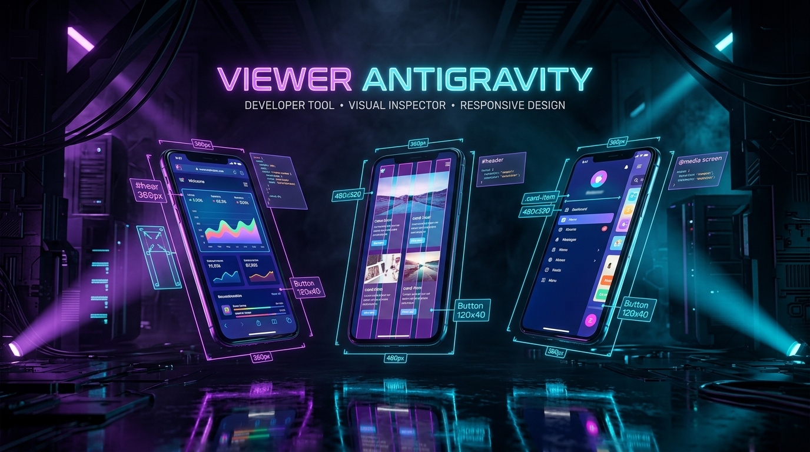
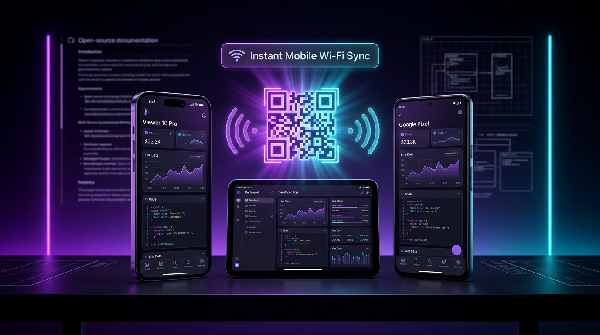
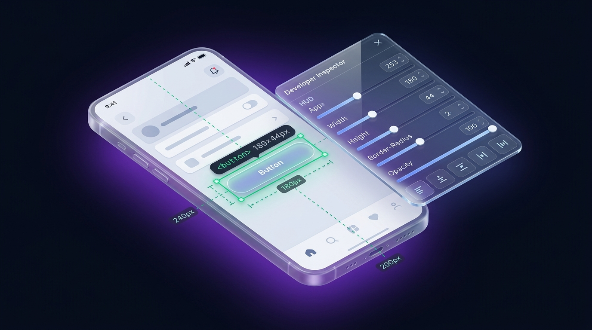

# ⚡ Viewer Antigravity

<p align="center">
  
</p>

<p align="center">
  <strong>Next-Gen Multi-Device Responsive Preview & Live Visual Inspection Studio</strong><br />
  Специализированная среда разработки и препросмотра для <b>Telegram Mini Apps</b>, мобильных сайтов и адаптивных веб-приложений.
</p>

<p align="center">
  <a href="https://github.com/VovanBloger/viewer_antigravity/stargazers"></a>
  <a href="https://nextjs.org"></a>
  <a href="https://react.dev"></a>
  <a href="https://tailwindcss.com"></a>
  <a href="https://core.telegram.org/bots/webapps"></a>
  <a href="LICENSE"></a>
</p>

---

## 🌟 О проекте

**Viewer Antigravity** — это автономная, ультрасовременная студия визуальной отладки и мульти-экранного тестирования. Она решает главную боль веб- и мобильной разработки: необходимость постоянно переключаться между вкладками, эмулятором Chrome DevTools и реальными устройствами.

Студия запускается локально в один клик, поддерживает препросмотр **любого локального или удалённого адреса** (`/demo`, `http://localhost:3000`, `http://localhost:3050` или production URL) и предоставляет глубокий визуальный инспектор DOM, ориентированный на парное программирование с современными **AI-ассистентами** (Antigravity, Claude, ChatGPT, Cursor).

---

## 🚀 Ключевые возможности

### 📱 1. Мульти-экранный воркспейс (Multi-Device Canvas)
- **Одновременный рендеринг до 3 устройств** на общем холсте с независимым или синхронизированным управлением.
- **Точные спецификации флагманских гаджетов**:
  - `iPhone 16 Pro` (393 × 852 px, Dynamic Island)
  - `iPhone 17 Pro Max` (421 × 914 px, Dynamic Island)
  - `iPhone SE` (375 × 667 px, Classic Bezel)
  - `Google Pixel 8` (412 × 892 px, Android Punch-Hole)
  - `Samsung Galaxy S24 Ultra` (412 × 899 px, Sharp Radius)
  - `iPad Mini` (768 × 1024 px, Tablet Viewport)
- Быстрый поворот экрана на **90° (Portrait / Landscape)**.
- Переключение между **реалистичным хардварным корпусом** (кнопки громкости, Dynamic Island, Home Indicator) и **безрамочным экраном**.
- Создание снимков экрана (**Screenshot 📸**) в один клик.

<p align="center">
  
</p>

### 🔄 2. Синхронизированный скролл и клики
- Скроллинг на одном экране плавно реплицируется на соседних в процентном соотношении высоты документа.
- Клики по табам, кнопкам и ссылкам зеркалируются на параллельных устройствах.

### 🔍 3. Живой визуальный инспектор DOM и слоёв
- **Point & Click выбор любого элемента** прямо внутри фрейма с мягкой подсветкой и бейджем с точными размерами (`W × H`).
- **Стек слоёв под курсором (`elementsFromPoint`)**: больше не нужно бороться с прозрачными `overlay`, модалками или подложками. Вы видите весь бутерброд слоёв в точке клика и можете прыгнуть на слой ниже кнопкой `⬇ Под ним`.
- **Временное скрытие перекрывающего слоя**: кнопка `Скрыть верхний слой` временно убирает мешающий контейнер, чтобы добраться до нужного элемента, и возвращает всё назад одной кнопкой.
- **Fiber React Metadata**: автоматическое извлечение имени React-компонента, пути к файлу в проекте и строки в коде.

<p align="center">
  
</p>

### 🎨 4. Точечный тюнер стилей (Style Tuner)
- **Прозрачность заливки (0% transparent)**: кнопка мгновенного обнуления фона без искажения текста или иконок.
- **Размеры**: числовой ввод ширины и высоты в `px`, `%` или `dvh`.
- **Скругление углов**: точный подбор `border-radius` в пикселях.
- **Выравнивание**: быстрые переключатели `text-left`, `center`, `right`.
- **Живые Tailwind классы**: введите класс в поле ввода — изменения мгновенно отобразятся в DOM.

### 📋 5. Экспорт промпта для AI-ассистента
- Выделили проблемный элемент, подобрали отступы или прозрачность, ввели пожелание в поле заметки — нажали `📋 СКОПИРОВАТЬ`.
- В буфер обмена попадает безупречно структурированный технический контекст со всеми селекторами, размерами, путями к компоненту и инструкцией, готовый для отправки в Antigravity или ChatGPT.

### 📲 6. Мгновенный мобильный тест по QR-коду
- Встроенный генератор QR-кодов позволяет отсканировать ссылку камерой смартфона и открыть проект на реальном устройстве по локальной Wi-Fi сети.

### 📳 7. Тактильная отдача и звуковой синтезатор Haptics
- Встроенный синтезатор на `Web Audio API` воспроизводит клики и вибрации при переключении табов и срабатывании Telegram Haptic Events.

---

## 🛠 Быстрый старт

### 1. Клонирование репозитория
```bash
git clone https://github.com/VovanBloger/viewer_antigravity.git
cd viewer_antigravity
```

### 2. Установка зависимостей
```bash
npm install
```

### 3. Запуск сервера разработки
```bash
npm run dev
```

Откройте в браузере: **[http://localhost:3000](http://localhost:3000)**

> [!TIP]
> Из коробки в студию встроено полнофункциональное интерактивное демо-приложение (`/demo`). Вы можете сразу исследовать интерфейс, не настраивая внешние серверы.

---

## 🎯 Подключение ваших проектов к Viewer Antigravity

В верхней панели студии расположена строка адреса **🌐 URL цели**:

| Пресет | Описание |
| :--- | :--- |
| **`⚡ /demo`** | Встроенное интерактивное приложение Telegram Mini App |
| **`💻 http://localhost:3000`** | Любой локальный фронтенд-проект (Next.js, Vite, React, Vue) |
| **`🔮 http://localhost:3050`** | Второй dev-сервер (например, kitty key studio) |
| **`🌐 Произвольный URL`** | Введите любой внешний адрес для адаптивного аудита |

Просто укажите адрес, нажмите **Перейти**, и все активные слоты мгновенно загрузят ваш проект с поддержкой инспектора и синхронизации!

---

## ⌨️ Горячие клавиши (Hotkeys)

| Клавиша | Действие |
| :--- | :--- |
| **`I`** или **`Alt + I`** | Включить / выключить режим визуального инспектора |
| **`Esc`** | Снять выделение с элемента / закрыть модальное окно |
| **`1`**, **`2`**, **`3`** | Переключение между активными слотами |

---

## 🏗 Структура проекта

```
viewer_antigravity/
├── app/
│   ├── api/
│   │   └── antigravity-bridge/   # Local Bridge API для синхронизации с Antigravity IDE
│   ├── demo/
│   │   └── page.tsx              # Встроенное адаптивное демо-приложение
│   ├── globals.css               # Tailwind CSS v4 и кастомные неоновые стили
│   ├── layout.tsx                # Корневой лэйаут с метаданными
│   └── page.tsx                  # Главный воркспейс студии препросмотра 2.0
├── components/
│   ├── demo/
│   │   └── DemoApp.tsx           # Интерактивный компонент витрины и ленты
│   ├── preview/
│   │   └── PhoneSlot.tsx         # Физический корпус смартфона и фрейм
│   └── workbench/
│       ├── AgentQueueView.tsx    # Пакетная очередь правок для ИИ-агента
│       ├── CodeBlueprintView.tsx # Архитектурные блюпринты и модули
│       ├── ColorPickerField.tsx  # Визуальный выбор цвета с пипеткой
│       ├── CommandPaletteModal.tsx # Палитра команд и QR-код для Wi-Fi
│       ├── HotkeysThemeView.tsx  # Настройка горячих клавиш и тем IDE
│       ├── LayerBuilderDock.tsx  # Дерево слоёв и визуальный тюнер
│       ├── LayoutAuditView.tsx   # Линтер мобильной вёрстки и Telegram Safe Area
│       └── TechnicalScreenshotModal.tsx # Визуально-технические скриншоты
├── lib/
│   ├── antigravity-core.ts       # Вычисление диффов, промпты и аудит
│   ├── dom-inspector.ts          # rAF-инспектор DOM, Fiber-метаданные и Box Model
│   ├── dom-layer-engine.ts       # 8-точечный интерактивный Gizmo и манипуляции DOM
│   ├── haptics.ts                # Синглтон Web Audio Haptics и отклик
│   ├── layer-builder.ts          # Движок адаптивных трансформаций слоёв
│   ├── preview-devices.ts        # Спецификации устройств (iPhone, Pixel, iPad)
│   ├── screenshot-engine.ts      # Canvas-генератор скриншотов с разметкой
│   └── utils.ts                  # Утилиты классов cn()
├── docs/
│   └── assets/                   # Графика и баннеры для документации
├── public/                       # Статические ассеты и иконки
├── package.json
└── tsconfig.json
```

---

## 🤝 Вклад в проект (Contributing)

Приветствуются любые пулл-реквесты, добавления новых моделей устройств и улучшения инспектора!

1. Форкните репозиторий (`Fork`).
2. Создайте ветку фичи (`git checkout -b feature/awesome-feature`).
3. Закоммитьте изменения (`git commit -m 'feat: Add new device spec'`).
4. Запушьте ветку (`git push origin feature/awesome-feature`).
5. Откройте **Pull Request**.

---

## 📄 Лицензия

Проект распространяется под открытой лицензией **MIT License**. Свободно для личного и коммерческого использования.

<p align="center">
  Разработано с ❤️ и <b>Antigravity</b> • Автор: <a href="https://github.com/VovanBloger"><b>@VovanBloger</b></a>
</p>
